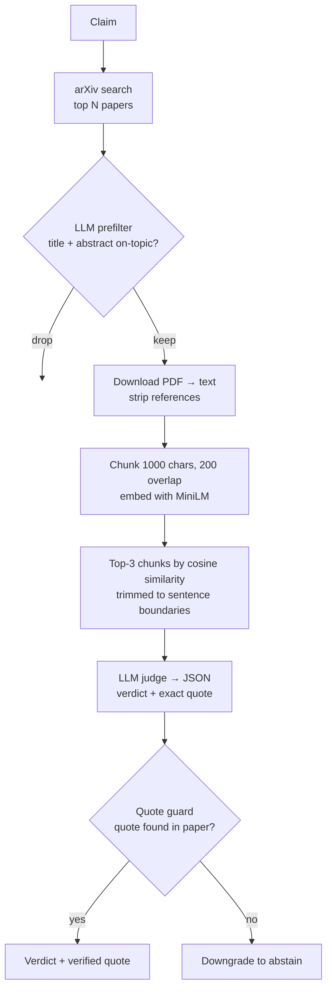

# Academic Research Agent

**Stage 1: claim → evidence checker.** Give it one research claim. It finds arXiv papers, reads their full-text PDFs, and judges each paper as **supports / opposes / irrelevant / abstain**. Every supports/opposes verdict comes with a quote that is *verified to appear in the paper*. It runs fully offline on a local LLM ([Ollama](https://ollama.com) + `qwen3`) and local embeddings.

Most "research assistant" demos summarise sources. This one evaluates sources *against a specific claim*, and it refuses to cite evidence it can't find in the text.

> **Scope:** the larger goal is topic → generated claims → evidence → synthesised paper. Only the evidence stage below is built. Claim generation, synthesis and LangGraph orchestration are on the roadmap, not in this repo.

## Architecture



| Module | Responsibility |
|---|---|
| `sources.py` | arXiv Atom API search; PDF download and text extraction; reference-section stripping |
| `evidence.py` | Chunking, embedding retrieval, sentence trimming, the **quote guard** |
| `llm.py` | The two LLM calls (prefilter and judge) and robust JSON parsing (strips `<think>` blocks and code fences) |
| `pipeline.py` | `check_claim()`: wires the stages together and returns results plus diagnostics |

### Why the quote guard matters

Local models paraphrase and still present the result as a quote. In a real run, the judge "quoted" *"AlphaFold 3's ability to generate realistic protein conformational ensembles…"*, a sentence that is not in the paper. The guard compares the quote against the paper text (with whitespace normalised). If it isn't there, the verdict is downgraded to `abstain`, so a fabricated quote can never back a verdict. Every run reports how many quotes the guard rejected.

## How to run

Requires Python 3.11+, internet access (for arXiv), and [Ollama](https://ollama.com) running locally.

```bash
ollama pull qwen3
python -m venv .venv && source .venv/bin/activate
pip install -r requirements.txt -e .

check-claim "AlphaFold fails to predict alternative protein conformations"
check-claim "your claim" --rows 3 --json     # fewer papers, machine-readable output
```

Or from Python:

```python
from research_agent import check_claim
out = check_claim("AlphaFold fails to predict alternative protein conformations", rows=5)
```

## Example output

Real run, with progress lines abridged:

```text
$ check-claim "AlphaFold fails to predict alternative protein conformations"
KEEP  AlphaFold predicts the most complex protein knot and composite protein
KEEP  Proteins with alternative folds reveal blind spots in AlphaFold-based
KEEP  From Prediction to Simulation: AlphaFold 3 as a Differentiable Framewo
DROP  Characterizing the Conformational States of G Protein Coupled Receptor
DROP  Mass Balance Approximation of Unfolding Improves Potential-Like Method
GUARD FIRED, quote was: AlphaFold 3's ability to generate realistic protein conformational ensembles ...

Claim: AlphaFold fails to predict alternative protein conformations

[IRRELEVANT] AlphaFold predicts the most complex protein knot and composite protein knots (2022)
  http://arxiv.org/abs/2207.07410v1
[SUPPORTS] Proteins with alternative folds reveal blind spots in AlphaFold-based protein structure prediction (2024)
  http://arxiv.org/abs/2410.14898v1
  "predictions of alternative folds are often inaccurate, low-confidence, or simply not predicted at all."
[ABSTAIN] From Prediction to Simulation: AlphaFold 3 as a Differentiable Framework for Structural Biology (2025)
  http://arxiv.org/abs/2508.18446v1

5 found, 3 kept, 3 judged, 0 PDF failures, 1 quotes rejected by the guard
```

The third paper is the guard at work: the judge said *supports*, but its "quote" wasn't in the paper, so the verdict became *abstain*.

## Tests

```bash
pip install -r requirements-dev.txt
pytest            # offline (~10 s): chunking, retrieval, JSON parsing, quote guard, full pipeline with fakes
pytest -m live    # also hits arXiv and runs a real claim through Ollama (several minutes)
```

## Limitations

- arXiv only. A CrossRef + Semantic Scholar backend was prototyped but isn't wired in.
- One claim at a time, processed sequentially. Five papers take about 5–6 minutes on a laptop with `qwen3`.
- The guard checks that the quote is real, not that it justifies the verdict.
- Reference stripping cuts at the last "References"/"Bibliography" heading, which is a heuristic.

## Roadmap

1. Topic → candidate claims (LLM)
2. Run `check_claim` per claim; orchestrate with LangGraph
3. Synthesise surviving evidence into a structured, cited write-up
